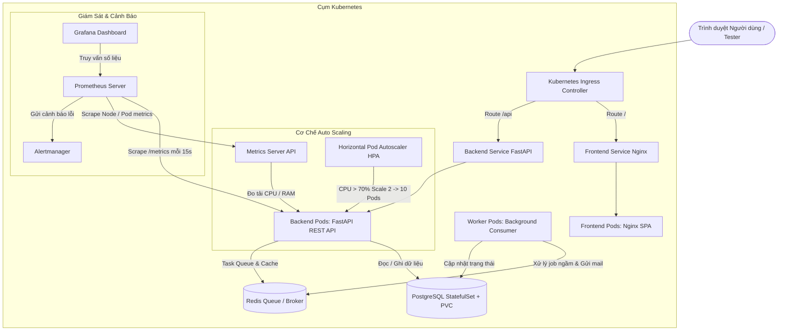

# 🏛️ Nền Tảng Microservices & Tự Động Co Giãn (Auto Scaling) với Docker & Kubernetes

> **Đề tài:** Xây dựng nền tảng Microservices với Docker, Kubernetes và cơ chế Auto Scaling  
> **Dự án thực tế:** MAISON' DÉCOR (Blanc Luxury) - Hệ thống Quản trị & Showroom Bán Lẻ Nội Thất Trực Tuyến  
> **Các tiêu chí cốt lõi:** Microservices Architecture, Containerization, Kubernetes Orchestration, Horizontal Pod Autoscaling (HPA), Full-Stack Observability (Metrics, Monitoring CPU/RAM, Dashboard, Alerting) & CI/CD Pipeline.

---

## 📑 Mục lục
1. [Kiến Trúc Hệ Thống (Architecture)](#-kiến-trúc-hệ-thống)
2. [Cấu Trúc Thư Mục Dự Án](#-cấu-trúc-thư-mục-dự-án)
3. [Các Trụ Cột Công Nghệ & Tiêu Chí Đề Tài](#-các-trụ-cột-công-nghệ--tiêu-chí-đề-tài)
4. [Hướng Dẫn Khởi Chạy Nhanh với Docker Compose](#-hướng-dẫn-khởi-chạy-nhanh-với-docker-compose)
5. [Hướng Dẫn Triển Khai Trên Cụm Kubernetes (K8s)](#-hướng-dẫn-triển-khai-trên-cụm-kubernetes-k8s)
6. [Kịch Bản Kiểm Thử Tải & Kích Hoạt Auto Scaling (HPA)](#-kịch-bản-kiểm-thử-tải--kích-hoạt-auto-scaling-hpa)
7. [Hệ Thống Giám Sát & Cảnh Báo (Observability & Alerting)](#-hệ-thống-giám-sát--cảnh-báo-observability--alerting)
8. [Tài Khoản & Cổng Dịch Vụ Mặc Định](#-tài-khoản--cổng-dịch-vụ-mặc-định)

---

## 🏛️ Kiến Trúc Hệ Thống

Hệ thống được thiết kế theo kiến trúc **Microservices phân tán, phi trạng thái (Stateless Services) kết hợp dịch vụ lưu trữ bền vững (Stateful Services)**:



---

## 📁 Cấu Trúc Thư Mục Dự Án

```
fastapi-postgres-todo-api-main/
├── backend/                       # Microservice Backend (Python FastAPI)
│   ├── auth.py                    # Module xác thực JWT, RBAC & phân quyền Admin
│   ├── database.py                # Cấu hình SQLAlchemy, Connection Pool & Seed Data
│   ├── models.py                  # Database Models (Users, Categories, Products, Orders)
│   ├── schemas.py                 # Pydantic Schemas v2 (Request/Response validation)
│   ├── main.py                    # FastAPI Entrypoint, Kubernetes Probes & Prometheus Metrics
│   ├── requirements.txt           # Thư viện phụ thuộc của Backend
│   ├── Dockerfile                 # Multi-stage Dockerfile tối ưu dung lượng & non-root user
│   └── tests/                     # Bộ Unit Test (Pytest + TestClient)
│       ├── conftest.py            # Fixture khởi tạo DB test
│       ├── test_api.py            # Test các endpoint API chính
│       └── test_main.py           # Test Probes & Swagger Docs
├── frontend/                      # Microservice Frontend (Nginx SPA)
│   ├── index.html                 # Giao diện Showroom Nội Thất Glassmorphism
│   ├── style.css                  # Thiết kế thẩm mỹ cao, Dark Mode & Responsive
│   ├── app.js                     # Quản lý State, Giỏ hàng, Đơn hàng & Tích hợp API
│   ├── nginx.conf                 # Cấu hình Web Server Nginx & Reverse Proxy
│   └── Dockerfile                 # Dockerfile Nginx Alpine serving SPA
├── worker-service/                # Microservice Xử lý nền (Background Worker)
│   ├── worker.py                  # Consumer lắng nghe Redis Queue, xử lý job bất đồng bộ
│   ├── requirements.txt           # Thư viện của Worker (Redis, SQLAlchemy, Psycopg2)
│   └── Dockerfile                 # Multi-stage Dockerfile cho Worker
├── k8s/                           # Toàn bộ Kubernetes Manifests
│   ├── backend-config-secret.yaml # ConfigMap & Secret cho biến môi trường
│   ├── backend-deployment.yaml    # Deployment & Service cho Backend (Port 8000)
│   ├── backend-hpa.yaml           # Horizontal Pod Autoscaler (Min 2, Max 10 Pods)
│   ├── frontend-deployment.yaml   # Deployment & Service NodePort (Port 30080)
│   ├── postgres-statefulset.yaml  # StatefulSet + Headless Service + PVC lưu trữ CSDL
│   ├── redis-deployment.yaml      # Deployment & Service Redis Message Queue
│   ├── worker-deployment.yaml     # Deployment cho Worker Service
│   └── ingress.yaml               # Ingress Controller định tuyến tên miền
├── monitoring/                    # Hệ thống Giám sát & Đo lường (Observability)
│   ├── metrics-server.yaml        # K8s Metrics Server (cung cấp số liệu CPU/RAM cho HPA)
│   ├── prometheus-configmap.yaml  # Cấu hình thu thập metrics & Luật cảnh báo (Alert Rules)
│   ├── prometheus-deployment.yaml # Deployment & Service Prometheus
│   ├── alertmanager-configmap.yaml# Cấu hình định tuyến cảnh báo sự cố
│   ├── alertmanager-deployment.yaml# Deployment & Service Alertmanager
│   ├── grafana-configmap.yaml     # Tự động nạp Prometheus DataSource & Dashboard
│   ├── grafana-deployment.yaml    # Deployment & Service Grafana (NodePort 32000)
│   └── dashboards/                # File JSON Dashboard giám sát Microservices
├── load-test/                     # Kịch bản kiểm thử tải (Locust)
│   └── locustfile.py              # Kịch bản bắn tải để demo Auto Scaling
├── .github/workflows/             # CI/CD Automation
│   └── ci-cd.yaml                 # Pipeline kiểm tra cú pháp và build & push Docker images
├── docker-compose.yml             # Điều phối chạy toàn bộ hệ thống cục bộ
└── .dockerignore                  # Loại trừ file thừa khi build Docker image
```

---

## 🎯 Các Trụ Cột Công Nghệ & Tiêu Chí Đề Tài

| Trụ cột | Chi tiết kỹ thuật đã triển khai |
| :--- | :--- |
| **Microservices** | Phân rã thành 5 dịch vụ riêng biệt: Frontend, Backend API, Worker Service, Redis Queue, PostgreSQL Database. |
| **Docker** | Toàn bộ các dịch vụ đóng gói bằng Dockerfile multi-stage, tối ưu cache và tuân thủ nguyên tắc an toàn với non-root user. |
| **Kubernetes (K8s)** | Điều phối tự động bằng Deployment, StatefulSet có PVC bền vững, Secret mã hóa, ConfigMap, và Ingress Controller. |
| **Auto Scaling (HPA)** | Đo lường CPU thời gian thực bằng `Metrics Server`. Khi CPU Backend vượt 70%, HPA tự động nhân bản Pod từ 2 lên tối đa 10 Pods. |
| **Observability** | Đo lường toàn diện: `/metrics` chuẩn Prometheus, `/healthz` (Liveness Probe), `/readyz` (Readiness Probe). |
| **Monitoring** | Prometheus thu thập dữ liệu định kỳ mỗi 15s từ tất cả các Pods trong cụm K8s thông qua Service Discovery. |
| **Dashboard** | Grafana trực quan hóa thời gian thực: Tần suất request (RPS), Độ trễ phản hồi P95, Tỷ lệ lỗi 4xx/5xx, CPU & RAM từng Pod. Tự động kết nối và nạp Dashboard khi khởi động. |
| **Alerting** | Alertmanager tự động phát cảnh báo khi tỷ lệ lỗi server vượt quá 5% (`HighHttpErrorRate`) hoặc khi Pod bị sập (`PodDown`). |
| **CI/CD Pipeline** | GitHub Actions tự động kiểm thử mã nguồn, chạy syntax test và đóng gói đẩy Docker Images lên Docker Hub khi có commit mới. |

---

## 🚀 Hướng Dẫn Khởi Chạy Nhanh Với Docker Compose

Chỉ cần một lệnh duy nhất để khởi động toàn bộ 5 dịch vụ (PostgreSQL, Redis, Backend, Worker, Frontend):

```bash
docker compose up --build
```

- **Giao diện Web:** [http://localhost](http://localhost) (Port 80)
- **Backend API & Swagger Docs:** [http://localhost:8000/docs](http://localhost:8000/docs)
- **Kiểm tra Probes:** [http://localhost:8000/healthz](http://localhost:8000/healthz) | [http://localhost:8000/readyz](http://localhost:8000/readyz)
- **Prometheus Metrics:** [http://localhost:8000/metrics](http://localhost:8000/metrics)

Để dừng hệ thống:
```bash
docker compose down
```

---

## ☸️ Hướng Dẫn Triển Khai Trên Cụm Kubernetes (K8s)

### Bước 1: Triển khai toàn bộ ứng dụng Microservices
Chạy các lệnh theo thứ tự chuẩn hóa sau:

```bash
# 1. Nạp biến môi trường & Secret
kubectl apply -f k8s/backend-config-secret.yaml

# 2. Khởi chạy cơ sở dữ liệu PostgreSQL (StatefulSet kèm Persistent Volume)
kubectl apply -f k8s/postgres-statefulset.yaml

# 3. Khởi chạy hàng đợi tin nhắn Redis
kubectl apply -f k8s/redis-deployment.yaml

# 4. Khởi chạy dịch vụ xử lý nền Worker
kubectl apply -f k8s/worker-deployment.yaml

# 5. Khởi chạy Backend API và Frontend Web
kubectl apply -f k8s/backend-deployment.yaml
kubectl apply -f k8s/frontend-deployment.yaml

# 6. Kích hoạt Ingress định tuyến
kubectl apply -f k8s/ingress.yaml
```

---

### Bước 2: Triển khai Hệ thống Giám sát & Tự động Co giãn (Observability & HPA)

```bash
# 1. Cài đặt Metrics Server (Bắt buộc để HPA đo được CPU/RAM)
kubectl apply -f monitoring/metrics-server.yaml

# 2. Kích hoạt Horizontal Pod Autoscaler (HPA) cho Backend
kubectl apply -f k8s/backend-hpa.yaml

# 3. Triển khai Prometheus (Monitoring Engine & Alert Rules)
kubectl apply -f monitoring/prometheus-configmap.yaml
kubectl apply -f monitoring/prometheus-deployment.yaml

# 4. Triển khai Alertmanager (Quản lý cảnh báo)
kubectl apply -f monitoring/alertmanager-configmap.yaml
kubectl apply -f monitoring/alertmanager-deployment.yaml

# 5. Triển khai Grafana (Tự động nạp Datasource & Dashboard)
kubectl apply -f monitoring/grafana-configmap.yaml
kubectl apply -f monitoring/grafana-deployment.yaml
```

Kiểm tra trạng thái toàn bộ hệ thống trên K8s:
```bash
kubectl get pods,svc,hpa
```

---

## 📈 Kịch Bản Kiểm Thử Tải & Kích Hoạt Auto Scaling (HPA)

Kịch bản Locust trong thư mục `load-test/` được viết để mô phỏng lượng người dùng truy cập lớn, tạo tải CPU thực tế để kích hoạt HPA:

### Cách thực hiện Demo:

1. **Cài đặt Locust trên máy (nếu chưa có):**
   ```bash
   pip install locust
   ```

2. **Khởi chạy Locust UI:**
   ```bash
   locust -f load-test/locustfile.py --host=http://localhost:8000
   ```
   *(Nếu chạy trên K8s qua NodePort, đổi host thành địa chỉ IP Node của cụm).*

3. **Mở trình duyệt truy cập:** [http://localhost:8089](http://localhost:8089)
   - **Number of users:** Nhập `200` (hoặc `500`)
   - **Spawn rate:** Nhập `20`
   - Nhấn **Start Swarming**.

4. **Quan sát quá trình tự động tăng Pods trên Terminal:**
   ```bash
   # Theo dõi HPA co giãn số Pod theo thời gian thực:
   kubectl get hpa backend-hpa -w
   
   # Theo dõi danh sách Pod mới được tạo ra:
   kubectl get pods -l app=backend -w
   ```
   *Kết quả:* Khi CPU vượt 70%, HPA sẽ tự động kích hoạt scale số lượng Pod backend từ **2 Pods lên 4, 6, 8 và tối đa 10 Pods**. Khi ngừng bắn tải, hệ thống sẽ tự động scale down về lại 2 Pods.

---

## 📊 Hệ Thống Giám Sát & Cảnh Báo (Observability & Alerting)

### 1. Truy cập Grafana Dashboard:
- **Địa chỉ:** [http://localhost:32000](http://localhost:32000) (NodePort `32000`)
- **Tài khoản:** `admin` / **Mật khẩu:** `admin123`
- Truy cập menu **Dashboards** -> Mở **Microservices Todo System Dashboard**:
  - 📈 **HTTP Request Rate (RPS):** Lưu lượng truy vấn thực tế theo từng API handler.
  - ⏱️ **P95 Response Time (Latency):** Thời gian phản hồi 95% request (đo bằng giây).
  - ⚠️ **HTTP Error Rate:** Tỷ lệ lỗi 4xx/5xx theo thời gian thực.
  - 💻 **Backend Pod CPU Usage (Cores):** Mức độ ngốn CPU của từng Pod backend.
  - 🧠 **Backend Pod Memory Usage (RAM):** Dung lượng RAM tiêu thụ của từng Pod backend.

### 2. Các Luật Cảnh Báo Tự Động (Alert Rules):
- **HighHttpErrorRate (Mức độ Critical):** Cảnh báo tự động kích hoạt khi tỷ lệ mã lỗi HTTP 5xx vượt quá 5% tổng lưu lượng trong vòng 1 phút.
- **PodDown (Mức độ Warning):** Cảnh báo tự động kích hoạt khi có bất kỳ Pod/Instance nào mất kết nối trong hơn 1 phút (`up == 0`).

---

## 🔑 Tài Khoản & Cổng Dịch Vụ Mặc Định

| Dịch vụ | Địa chỉ truy cập | Ghi chú & Tài khoản |
| :--- | :--- | :--- |
| **Giao diện Người dùng (Frontend)** | `http://localhost` (Docker) hoặc `http://localhost:30080` (K8s) | Giao diện Showroom Noir/Glassmorphism |
| **Backend REST API** | `http://localhost:8000` | FastAPI Framework |
| **Swagger UI Documentation** | `http://localhost:8000/docs` | Đầy đủ OpenAPI Spec cho tất cả API |
| **Tài khoản Quản trị (Admin)** | Đăng nhập trên giao diện Web | `admin@blanc.vn` / `admin123` |
| **Prometheus Dashboard** | `http://localhost:9090` | Thu thập metrics và đánh giá alert rules |
| **Grafana Dashboard** | `http://localhost:32000` | User: `admin` / Password: `admin123` |
| **Alertmanager** | `http://localhost:9093` | Tiếp nhận và phân phối thông báo sự cố |

---

## 🧪 Chạy Kiểm Thử Tự Động (Unit Tests)

```bash
pytest backend/tests -v
```
Toàn bộ **10/10 test cases** đều được đảm bảo PASS trước khi deploy!
